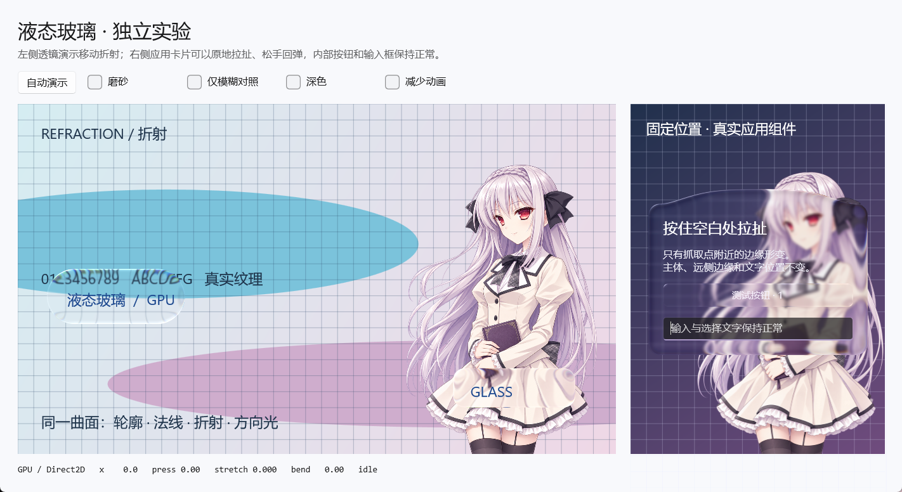
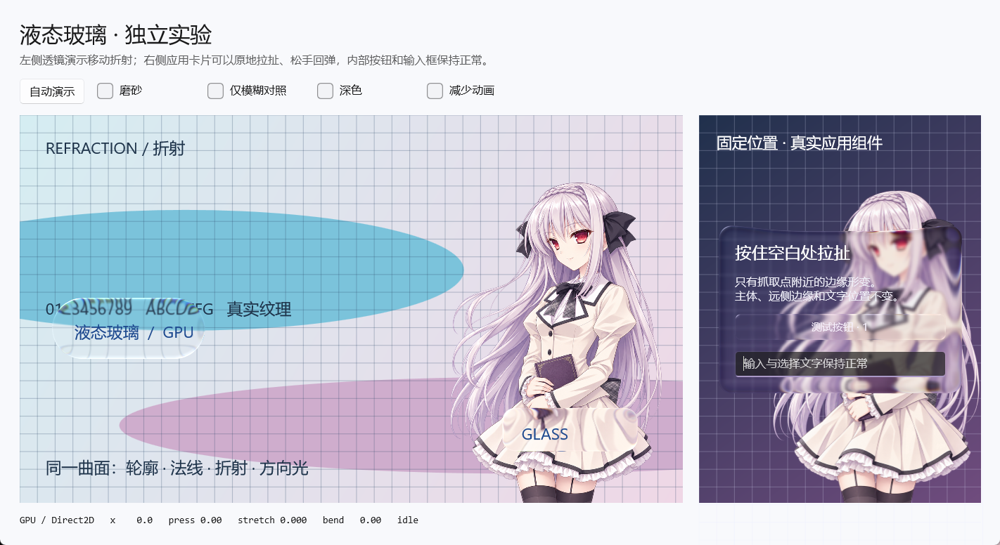

# WinUI 液态玻璃实验

可独立构建的 WinUI 3 / Win2D / Direct2D 示例，从真实桌面应用中提取光学与交互层。运行无需应用账号、数据库或网络服务。

左侧为可移动透镜；右侧为固定卡片和原生按钮。**固定卡片只在抓取点附近产生局部拉扯，远处边缘、主体与文字留在原位。** 松手弹回，按钮仍可点击，输入框仍可编辑。移动透镜与固定组件使用不同的运动模型。


| 局部向外拉扯 | 反向拉扯 |
| --- | --- |
|  |  |

截图记录真实窗口与鼠标状态；连续回弹请运行示例观察。图片是原生客户端区域捕获，没有生成式修图。

## 构建与运行

在 Windows 上使用 .NET 10 SDK、Windows SDK / WinUI 构建工具。`global.json` 指定测试使用的 SDK 10.0.400；依赖固定为 Windows App SDK 2.3.1、Win2D 1.4.0、ComputeSharp 3.2.0。仅验证 Windows x64。

在本目录运行：

```powershell
.\scripts\run.ps1
.\scripts\run.ps1 -Capture
dotnet test .\tests\LiquidGlass.Tests.csproj -c Release
dotnet run --project .\tools\GlassProbe\GlassProbe.csproj -c Release -- build\probe
```

程序位于 `build/app/LiquidGlassDemo.exe`，应保留整个发布目录的依赖。脚本通过桌面 shell 启动，避免打包调用方干扰 `ms-appx` 资源身份；复制文件后直接打开 EXE 也可运行。无需提升权限。

`-Capture` 预热资源后输出移动透镜七个阶段、固定卡片与按钮各六个阶段，以及两份状态记录。这是模型驱动的 GPU 捕获，不冒充鼠标测试。

真实鼠标检查需解锁且无人操作的桌面，并保持 Demo 在前台：

```powershell
python -m pip install pywinauto pillow
python .\scripts\capture-pointer.py <Demo进程ID> build\pointer-check
```

它检查实际按住/释放、前台窗口、轨迹位置、正文坐标、一次按钮点击和输入框编辑。被其他输入打断会失败，不能把这次图片当作目标阶段证据。`PrintWindow` 在本环境返回过旧回退层，因此脚本捕获实际可见的客户端区域。

## 接入自己的组件

- `src/Demo/Controls/`：距离字段 shader、共享场景、渲染器、表面及原生输入观察器。
- `src/Demo/Core/`：移动透镜和局部拉扯两个模型、光学坐标与尺寸工具。
- `src/Demo/Themes/`：原生面板/按钮模板；正文独立于光学形变，静态回退边框在 GPU 就绪后隐藏。
- `src/Demo/DemoServices.cs`：示例的诊断接收器。集成时替换为宿主日志，不需接入原应用服务。

用 `LiquidGlassScope.SetScene` 注册独立背景图层，或给 `GlassPanel.BackdropSource` 指定单独的装饰元素。不要将包含玻璃自身的祖先作为捕获源。可将组件所需文件提取到宿主项目；先处理宿主资源、命名空间与回调，避免整套替换业务主题。

本示例采样独立网格/插画层，在尺寸、主题和图像变化时重新捕获。它不声称实时捕获 WebView、视频或任意桌面窗口。高对比度/关闭透明效果使用实体回退；减少动画取消形变。鼠标按住值不是实际压力传感器读数。

## 验证与许可

37 项模型/坐标单测与 14 项 Direct2D GPU 检查。局部形变额外核对对侧边缘、远处角点和主体纹理，并验证释放后至少 4 DIP 的反向回弹。原生鼠标测试还要求屏幕上的边缘确实向布局外鼓起，防止绘制层被圆角容器裁掉。详见[迁移复盘](../../docs/winui-retrospective.md)。不同硬件帧率、跨显示器 DPI 热切换与其他后端仍需目标环境检查。

光学来源与 ComputeSharp 许可保留在 `src/Demo/Assets/GlassNotices/`。人物是原桌面主题的 AI 同人插画，角色权利属于原权利方，与软件许可分开说明；更换插画不影响组件。原有 Flutter 实现及许可证保持独立。
