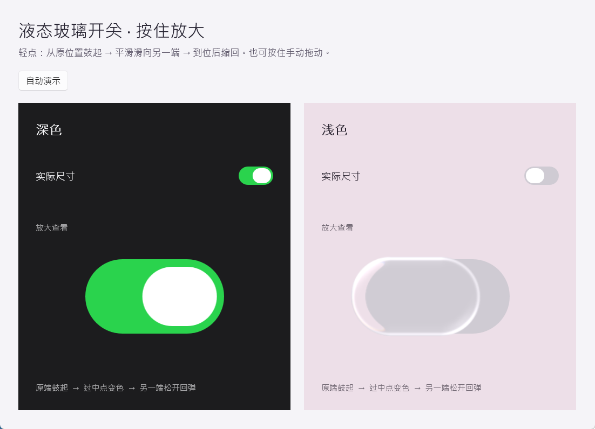

# WinUI 液态玻璃实验

可独立构建的 WinUI 3 / Win2D / Direct2D 示例，从真实桌面应用中提取光学与交互层。运行无需应用账号、数据库或网络服务。

左侧为可移动透镜；右侧为采用 design-systems 弹簧模型的原生卡片与按钮。整块组件和文字短暂跟手，速度驱动拉伸，滞后驱动曲面弯曲，松手返回原位。宿主采用较克制的参数：指针位移乘 0.18，卡片最多 12 DIP、按钮最多 4 DIP。背景清晰透射，圆角、法线、折射和高光来自同一曲面。


| 跟手与边缘折射 | 反向与回弹 |
| --- | --- |
|  |  |

截图记录真实窗口与鼠标状态；连续回弹请运行示例观察。图片是原生客户端区域捕获，没有生成式修图。

## 构建与运行

在 Windows 上使用 .NET 10 SDK、Windows SDK / WinUI 构建工具。`global.json` 指定测试使用的 SDK 10.0.400；依赖固定为 Windows App SDK 2.3.1、Win2D 1.4.0、ComputeSharp 3.2.0。仅验证 Windows x64。

在本目录运行：

```powershell
.\scripts\run.ps1
.\scripts\run.ps1 -Capture
dotnet test .\tests\LiquidGlass.Tests.csproj -c Release
dotnet run --project .\tools\GlassProbe\GlassProbe.csproj -c Release -- build\probe
```

程序位于 `build/app/LiquidGlassDemo.exe`，应保留整个发布目录的依赖。脚本通过桌面 shell 启动，避免打包调用方干扰 `ms-appx` 资源身份；复制文件后直接打开 EXE 也可运行。无需提升权限。

`-Capture` 预热资源后输出移动透镜七个阶段、弹性卡片与按钮各六个阶段，以及两份状态记录。这是模型驱动的 GPU 捕获，不冒充鼠标测试。

真实鼠标检查需解锁且无人操作的桌面，并保持 Demo 在前台：

```powershell
python -m pip install pywinauto pillow
python .\scripts\capture-pointer.py <Demo进程ID> build\pointer-check
```

它检查实际按住/释放、前台窗口、轨迹位置、正文随动/回原位、拖动按钮不误触、点击一次、键盘激活及输入/选择。被其他输入打断会失败，不能把这次图片当作目标阶段证据。`PrintWindow` 在本环境返回过旧回退层，因此脚本捕获实际可见的客户端区域。

## 放大开关 Demo

```powershell
.\scripts\run.ps1 -Switch
```

`src/SwitchDemo` 直接链接 `src/Demo` 中的控件、模板、运动模型与 shader；浅色、深色及四倍预览使用同一份实现。轨道 56×30 DIP、普通滑块 30×24 DIP、按住约 52×32 DIP。开启保持不透明绿色，轻点先在原端鼓起，再滑到另一端收回；自动演示使用相同路径，按最终反馈提速 15%。手动拖动保留原有跟手、取消和松手提交语义。



```powershell
python scripts/capture-toggle-motion.py <放大Demo进程ID> build/switch-tap --toggle-id=LightActual --tap
python scripts/capture-toggle-motion.py <综合Demo进程ID> build/switch-drag
python scripts/capture-toggle.py <综合Demo进程ID> build/switch-optics --compare-optics
python scripts/capture-button.py <综合Demo进程ID> build/button-optics
```

这些脚本通过真实系统鼠标录制当前可见窗口。开关录制默认不读取业务设置；针对自己的宿主验证取消不写配置时，显式传入 `--cancel --settings-file=<文件>`。

## 接入自己的组件

- `src/Demo/Controls/`：距离字段 shader、共享场景、渲染器、表面及原生输入观察器。
- `src/Demo/Core/`：移动透镜和锚定回弹两个模型、光学坐标与尺寸工具。
- `src/Demo/Themes/`：原生面板/按钮模板；正文与整个组件共享 affine pose，shader 只额外处理曲面滞后弯曲；GPU 就绪后隐藏静态回退边框。
- `src/Demo/DemoServices.cs`：示例的诊断接收器。集成时替换为宿主日志，不需接入原应用服务。

用 `LiquidGlassScope.SetScene` 注册独立背景图层，或给 `GlassPanel.BackdropSource` 指定单独的装饰元素。不要将包含玻璃自身的祖先作为捕获源。可将组件所需文件提取到宿主项目；先处理宿主资源、命名空间与回调，避免整套替换业务主题。

本示例采样独立网格/插画层，在尺寸、主题和图像变化时重新捕获。它不声称实时捕获 WebView、视频或任意桌面窗口。高对比度/关闭透明效果使用实体回退；减少动画取消形变。鼠标按住值不是实际压力传感器读数。

## 验证与许可

58 项模型/坐标单测与 36 项 Direct2D GPU 检查。运动轨迹来自 design-systems `7a424c93b9be13cf835b91ea67495fec2ec0584e` 的实际 `JellyController.tick`，逐帧比较跟手、反向、释放和再次抓取；另测宿主的小幅度参数、边界、不同帧率与原点。GPU 检查包括外部 affine 变换不会重复应用、法线映射与滞后弯曲。原生捕获额外检查实际 shader uniform 的逆矩阵有效，防止独立探针通过、宿主却丢失折射。详见[迁移复盘](../../docs/winui-retrospective.md)。

更新参考轨迹（先检出上述精确版本）：

```powershell
node scripts/generate-reference-motion.mjs <design-systems仓库目录>
```

参考方程保持原值；宿主只调整位移增益和上限。清晰玻璃默认 blur 0.25 DIP，大卡片的曲面带按短边比例扩展至最多 40 DIP，玻璃面板圆角 28 DIP。跨显示器 DPI 热切换与其他后端仍需目标环境验证。

光学来源与 ComputeSharp 许可保留在 `src/Demo/Assets/GlassNotices/`。人物是原桌面主题的 AI 同人插画，角色权利属于原权利方，与软件许可分开说明；更换插画不影响组件。原有 Flutter 实现及许可证保持独立。

开关示例：按住时透明玻璃滑块，左右拖动连续变色，松手后才提交开关状态并还原普通滑块。`scripts/capture-toggle.py PID 输出目录` 检查反向预览、取消、点击、键盘与 UIA TogglePattern。
